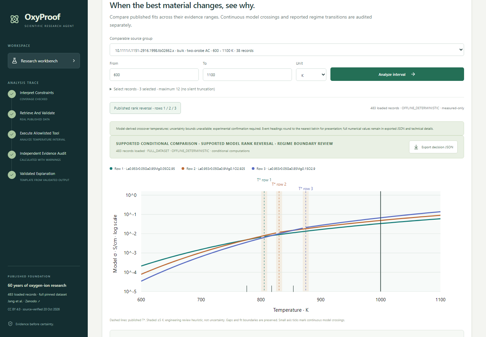

# OxyProof

**An evidence-grounded research agent for oxygen-ion conductor screening.**

OxyProof helps researchers compare published oxide-conductor records, calculate ionic conductivity at a requested temperature, and see where the evidence stops. It combines a **Python/FastAPI scientific engine**, a **React/TypeScript research dashboard**, and optional **LLM tool selection**. Scientific values and citations come from validated calculations and source records.

Built for the **Open Scientific Intelligence Hackathon 2026**.

**[Watch the 3:15 narrated demo](output/osi-final/browser-demo/oxyproof-browser-demo-final-subtitled-narrated.mp4)** · [One-page write-up](output/osi-final/submission/oxyproof-one-page-final.pdf) · [Run locally](#run-locally) · [Scientific evidence](docs/SCIENTIFIC_ACCEPTANCE.md)



## What it does

> How does the ranking of three comparable oxygen-ion conductors change between 700 and 1000 K, and which conclusions are actually supported?

| Research task                      | What OxyProof provides                                                                                            |
| ---------------------------------- | ----------------------------------------------------------------------------------------------------------------- |
| Screen at an operating temperature | Conductivity in S/cm, conditional source-group rankings, valid regimes and explicit exclusions                    |
| Find when the ranking changes      | Analytical model intersections, an interactive temperature slider and separate review of published fit boundaries |
| Inspect the evidence               | Dataset row, formula, source DOI, fit parameters, units, warnings and an exportable JSON trace                    |
| Handle an unsupported requirement  | A typed refusal and proposed follow-up measurements rather than an invented recommendation                        |

The flagship example uses three curated Huang-source records. Their **conditional model order is 1 > 2 > 3 at 700 K and 3 > 2 > 1 at 1000 K**. Calculated crossings near **776, 818 and 854 K** explain the change. They are **model-derived intersections, not measured crossover temperatures**. See the [independent numerical reference and source limitations](docs/SCIENTIFIC_ACCEPTANCE.md).

## Run locally

### Requirements

- **Python 3.12–3.14**; the reference Windows environment uses Python 3.12.13.
- **[uv](https://docs.astral.sh/uv/getting-started/installation/)** on your PATH.
- **Node.js 22.12+ and npm**; the lockfile was validated with Node.js 26.5.0.
- Internet access for the first dependency installation and full-dataset download.

**No API key, paid model or cloud deployment is needed for the default demonstration.**

### First launch

```sh
git clone https://github.com/miku-wwl/oxyproof-osi-2026.git
cd oxyproof-osi-2026
python scripts/start.py
```

Open **http://127.0.0.1:8000**. Stop the server with **Ctrl+C**.

Startup installs the locked dependencies, downloads and verifies the pinned public CSV, builds the dashboard, and starts the local API. The same origin serves both the dashboard and API.

If the full CSV cannot be downloaded and no full-data cache exists, OxyProof uses the bundled **24-row real published-data fixture**, visibly labelled in the interface. A changed or corrupt cached full dataset is rejected. Inspect the loaded scope at **http://127.0.0.1:8000/api/health**.

### Subsequent launches without network access

After the first successful setup:

```sh
python scripts/start.py --offline
```

This skips dependency installation, dataset retrieval and frontend rebuilding. It requires the installed environment and built dashboard. The bundled fixture supports deterministic analysis even when the full CSV is absent.

Use `python3` instead of `python` where required. Startup has been exercised on Windows; POSIX compatibility is intended but has not been independently validated in the recorded acceptance.

<details>
<summary>Manual setup, frontend development and troubleshooting</summary>

Run from the repository root:

```sh
uv sync --locked --link-mode copy
uv run --no-sync python scripts/fetch_data.py
npm ci --prefix frontend --no-fund --no-audit
npm run build --prefix frontend
uv run --offline --no-sync python -m uvicorn backend.app.main:app --host 127.0.0.1 --port 8000
```

For frontend editing, keep the API running and use `npm run dev --prefix frontend` in another terminal. Vite proxies `/api` to port 8000. The production dashboard needs only the API server.

- **Missing uv/npm:** install the prerequisite and open a new terminal so PATH is refreshed.
- **Dashboard not built:** run the first-launch command with network access, or the manual frontend install/build commands above.
- **Port 8000 occupied:** reuse your existing OxyProof server, or select `--port 8001` in the manual uvicorn command and open that address. Adapt API examples accordingly.
- **Dataset verification failure:** inspect the reported checksum/source error. Do not bypass integrity checks; [source and retrieval details](docs/SOURCES.md) identify the pinned file.
- **Environment settings:** defaults require no `.env`. Optional providers are described in [.env.example](.env.example); an ignored `.env` can be loaded explicitly with uvicorn `--env-file .env`.

</details>

## Try the demonstration

1. **Explore the ranking reversal.** In **Temperature Decision Explorer**, select **Published rank reversal · rows 1 / 2 / 3**, set **700–1000 K**, and click **Analyze interval**. Move the slider and compare the 700 K and 1000 K orders.
2. **Inspect the evidence.** Open model-event cards and source details. Continuous model crossings and published T* fit boundaries are separate; uncertainty bounds are unavailable. Click **Export decision JSON** for the full trace.
3. **Replay genuine model tool use.** In **Research Agent execution**, expand **Recorded DeepSeek acceptance**, load the saved traces, and choose **Replay B**. Inspect the earlier real model-selected tool, validated arguments, deterministic result and independent audit. Replay makes **zero new inference requests**.
4. **Watch the agent abstain.** Choose **Replay C** for the 600 °C / 10% humidity / 10,000-hour request. Unsupported requirements cause the independent validator to block scientific execution and recommend no candidates. The default offline workflow can also check this request.
5. **Challenge the formula.** Open **Wrong-formula audit**. Reusing this dataset's prefactor without the required `1/T` factor is rejected on physical/unit grounds; the invalid expression never enters the ranking.

The [narrated demo](output/osi-final/browser-demo/oxyproof-browser-demo-final-subtitled-narrated.mp4) follows the real selection → analysis → slider → recorded B/C replay → JSON-export workflow. [Without subtitles](output/osi-final/browser-demo/oxyproof-browser-demo-final-clean-narrated.mp4) · [Video provenance and QA](output/osi-final/browser-demo/FINAL_VIDEO_POLISH_ACCEPTANCE.md) · [Narration processing and review limits](output/osi-final/browser-demo/NARRATION_MIX_ACCEPTANCE.md).

## How the agent works

```text
Research request
  → bounded tool plan
  → independent request and evidence validation
  → deterministic physics / source inspection
  → evidence audit, grounded explanation and JSON export
```

The allowlist contains `screen_published_records`, `analyze_temperature_interval` and `inspect_scientific_evidence`. An LLM can choose a tool and propose typed arguments. It cannot execute arbitrary code, add citations, override missing evidence or calculate the reported scientific values. Unknown or contradictory requirements fail closed, including in real-LLM mode. See the [request grammar](docs/REQUEST_GRAMMAR.md).

| Runtime or evidence mode | Meaning                                                                                               |
| ------------------------ | ----------------------------------------------------------------------------------------------------- |
| `OFFLINE_DETERMINISTIC`  | Default: bounded deterministic parsing and real-data calculations; no model call                      |
| `REAL_LLM`               | Optional provider selects an allowed tool; independent validation and calculations control the result |
| `RECORDED_TRACE_REPLAY`  | Archived genuine DeepSeek executions, clearly labelled; no fresh inference                            |
| `UNAVAILABLE`            | Required operation failed or is unconfigured; no silent fallback presented as successful inference    |

**Recorded live evidence:** three genuine DeepSeek requests passed independent acceptance on **October 21, 2026 NZDT**: screening, interval analysis and unsupported-constraint abstention. These are demonstrated cases, not a general model-accuracy benchmark. The three-request sprint budget is exhausted; use offline analysis or replay for reproduction. [Exact provider evidence and limits](docs/DEEPSEEK_LIVE_ACCEPTANCE.md).

DeepSeek, OpenAI and local Ollama adapters are implemented. Only the recorded DeepSeek scenarios have the live acceptance claimed here; the [Ollama native tool-acceptance failure](docs/OLLAMA_REAL_AGENT_ACCEPTANCE.md) remains disclosed. New live calls require separate provider setup and owner authorization. Secrets belong in your environment, never in this repository.

## Scientific data and calculation contract

Source: **Jang, Kiyohara, Takamura and Kumagai (2026), _Charting the Landscape of Oxygen Ion Conductors: A 60-Year Dataset_**, [Zenodo record 18947543](https://zenodo.org/records/18947543), DOI **10.5281/zenodo.18947543**. The [accompanying publication](https://www.nature.com/articles/s41597-026-07100-x) documents the curated model convention.

The pinned full CSV contains **483 records, 34 columns and 84 source DOIs**. Records describe reported compositions/conditions, not necessarily unique materials. Setup downloads the full file; the attributed [24-row fixture manifest](backend/app/data/fixtures/manifest.json) identifies every bundled source row. [Source audits](docs/SOURCES.md) record access dates, schema, units, license evidence and unresolved original-paper checks.

For this dataset's curated prefactors:

```text
sigma(T) × T = A × exp(-Ea / (k_B × T))
sigma(T)     = A/T × exp(-Ea / (k_B × T))

Ea: dataset meV → eV       k_B: eV/K
A:  K·S/cm                 T:   K
sigma: S/cm                Celsius inputs: K = °C + 273.15
```

This prefactor convention is dataset-specific. Low/high-temperature fits are selected only within validated regimes; exact ambiguous T* values and missing prerequisites are withheld. Interval decisions use analytical roots and fixed-regime intersections, not chart resolution. The ±5 K review neighborhood and numerical equality tolerances are engineering heuristics, not uncertainty bounds.

Pinned full-file SHA-256:

```text
8ec66b131bae79f8520f7cf40e91e2be2541995939bc43b744eaac627f4fad34
```

Reports carry source row IDs, DOI, raw inputs, units, formula/regime selection, code fingerprint and warnings. Original full experimental methods and sample conditions have not all been independently checked. Shared source-group metadata does not prove identical preparation or atmosphere. Rankings are conditional model-based screening, not performance guarantees, new measurements, new-material discoveries or validated uncertainty intervals. [Scientific acceptance and limits](docs/SCIENTIFIC_ACCEPTANCE.md) · [Temperature-decision method](docs/TEMPERATURE_DECISIONS.md).

## API

Interactive schemas: **http://127.0.0.1:8000/docs**.

| Endpoint                              | Purpose                                                                |
| ------------------------------------- | ---------------------------------------------------------------------- |
| `GET /api/health`                     | Loaded scope, checksum, code version and provider configuration status |
| `GET /api/catalog`                    | Records and comparison groups                                          |
| `GET /api/records/{row_id}`           | Source record and provenance                                           |
| `POST /api/screen`                    | Single-temperature screening                                           |
| `POST /api/temperature-decisions`     | Measured-only interval analysis and selected-temperature rankings      |
| `POST /api/research`                  | Bounded tool planning and audited execution                            |
| `GET /api/research/recorded-deepseek` | Archived genuine provider traces                                       |

Example interval request, in PowerShell:

```powershell
Invoke-RestMethod -Uri 'http://127.0.0.1:8000/api/temperature-decisions' -Method Post -ContentType 'application/json' -Body '{"row_ids":[1,2,3],"temperature_min":700,"temperature_max":1000,"temperature_unit":"K","selected_temperatures":[700,1000],"mode":"OFFLINE_DETERMINISTIC"}'
```

The response's `selected_rankings` contains orders `[1,2,3]` at 700 K and `[3,2,1]` at 1000 K, with calculated S/cm values, regimes and warnings.

## Reproduce and verify

After setup, these commands require no fresh model requests:

```sh
uv run --offline --no-sync python -m pytest -q
npm run test --prefix frontend
npm run build --prefix frontend
uv run --offline --no-sync python scripts/verify_final_science.py
```

Complete acceptance workflow, including genuine local Chromium tests:

```sh
# First-time browser installation requires network access.
uv run --offline --no-sync python scripts/browser_e2e.py --install
uv run --offline --no-sync python scripts/validate_v2.py --browser --phase262
```

The validator disables cloud access and regenerates evidence/logs. Browser tests use a separate loopback server on port 8011. Provider-transport mocks, real-browser tests and archived live calls are distinct evidence categories.

**Recorded acceptance snapshot — October 21, 2026 NZDT:**

| Check                                      | Recorded result                             |
| ------------------------------------------ | ------------------------------------------- |
| Backend tests                              | 255 passed                                  |
| Frontend component tests                   | 12 passed                                   |
| Genuine Chromium tests                     | 21 passed                                   |
| Frozen scientific decision-integrity cases | 49/49 passed                                |
| Genuine DeepSeek scenarios                 | 3 requests, 3 independent acceptance passes |

Sources: [regression outputs](artifacts/deepseek_regression.json), [scientific case results](artifacts/scientific_benchmark_v2.json), [live acceptance](docs/DEEPSEEK_LIVE_ACCEPTANCE.md). These are dated recorded results. The 49 cases are hand-selected guards, not representative accuracy or statistical significance; some adversarial cases are explicitly synthetic. Scientific demonstration records come from the real published fixture.

<details>
<summary>Additional reproducible analyses and checks</summary>

```sh
uv lock --check --offline
uv run --offline --no-sync python -m ruff check backend scripts tests benchmarks
uv run --offline --no-sync python -m ruff format --check backend scripts tests benchmarks
npm run lint --prefix frontend
uv run --offline --no-sync python scripts/demo.py
uv run --offline --no-sync python scripts/reference_values.py
uv run --offline --no-sync python benchmarks/evaluate.py
uv run --offline --no-sync python benchmarks/evaluate_v2.py
uv run --offline --no-sync python scripts/phase2_demo.py
```

With the default API running, `uv run --offline --no-sync python scripts/smoke.py` checks real local HTTP and writes `artifacts/http_smoke.json`. The analysis commands also regenerate associated artifacts. See [benchmark methodology](docs/EVALUATION_V2.md) for case selection and baseline limits.

</details>

## Repository guide

| Path                                     | Contents                                                               |
| ---------------------------------------- | ---------------------------------------------------------------------- |
| [`backend/app/`](backend/app/)           | FastAPI, ingestion, typed tools, physics and evidence auditing         |
| [`frontend/`](frontend/)                 | React dashboard, component tests and browser tests                     |
| [`scripts/`](scripts/)                   | Startup, data retrieval, independent references and acceptance runners |
| [`tests/`](tests/)                       | Scientific, API, planner and provider-contract tests                   |
| [`benchmarks/`](benchmarks/)             | Educational guards and frozen decision-integrity cases                 |
| [`artifacts/`](artifacts/)               | Saved reports, validation evidence and real-browser screenshots        |
| [`docs/`](docs/)                         | Source audits, assumptions, acceptance reports and demo guides         |
| [`output/osi-final/`](output/osi-final/) | Narrated demonstration, one-page write-up and media provenance         |

For review: [scientific sources](docs/SOURCES.md) · [assumptions](docs/SCIENCE_ASSUMPTIONS.md) · [request grammar](docs/REQUEST_GRAMMAR.md) · [DeepSeek demo guide](docs/DEEPSEEK_AGENT_DEMO.md) · [submission checklist](docs/SUBMISSION_CHECKLIST.md).

Development began on **October 20, 2026**. Competition registration, eligibility and final submission are owner-controlled; historical phase handovers describe their own snapshots, not current submission status.

## License and attribution

Original application code is [MIT licensed](LICENSE). The scientific dataset is **CC BY 4.0**, with attribution to Jang, Seong-Hoon; Kiyohara, Shin; Takamura, Hitoshi; Kumagai, Yu (2026), Zenodo, DOI [10.5281/zenodo.18947543](https://doi.org/10.5281/zenodo.18947543). The bundled fixture discloses its selected rows and preserves original field strings.

Article text/figures and dependency licenses have separate rights; no publication figures or full article text are redistributed. See [third-party notices](THIRD_PARTY_NOTICES.md) and [source-rights evidence](docs/SOURCES.md).
